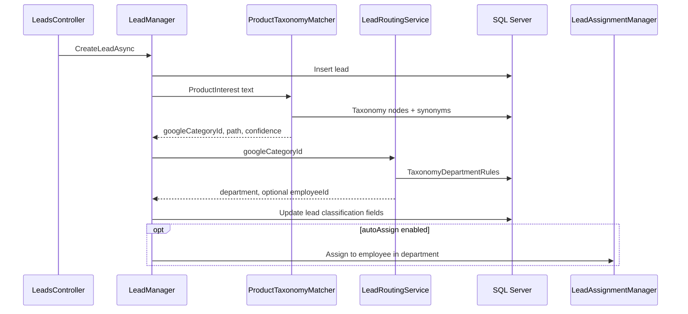

# BTN — Google Product Taxonomy & auto department routing

**Project:** Business Trust Network (`d:\btn`)  
**Not in scope:** LexBOTDevelopment — taxonomy routing was discussed there by mistake; implement only in BTN.

**Goal:** When a lead is created with free-text product info (`ProductInterest` on `backend/src/BTN.Data/Entities/BtnEntities.cs`), classify it to a **Google product category ID**, map that ID to an internal **department**, and optionally **auto-assign** an employee in that department using existing assignment patterns in `backend/src/BTN.Business/LeadAssignment/LeadAssignmentManager.cs`.

**Reference data:** [Google taxonomy with IDs](https://www.google.com/basepages/producttype/taxonomy-with-ids.en-US.txt) (e.g. `605` = Air Conditioners). This is **not** Indian GST HSN.

---

## Implementation checklist

- [ ] Add `data/taxonomy/` (source `.txt`, generated `nodes.json`, config `department-map.json` + `synonyms.json`) + import script
- [ ] EF entities: `GoogleTaxonomyNode`, `TaxonomyDepartmentRule`, `TaxonomySynonym`; migration; seed from import output
- [ ] `BTN.Business`: `IProductTaxonomyMatcher` (token/synonym match, parent inheritance in rules)
- [ ] `BTN.Business`: `ILeadRoutingService` — department from rules; pick active employee by `Employee.Department`
- [ ] Extend `Lead` + `CreateLeadAsync`; optional auto-assign via `LeadAssignmentManager`; `LeadResponse` fields
- [ ] Admin CRUD for department rules; taxonomy search; show classification on lead/verification UI

---

## How BTN fits today

| Existing piece | Location | Use for routing |
|----------------|----------|-----------------|
| Lead product text | `Lead.ProductInterest` | Input to matcher |
| Employee team | `Employee.Department` (string) | Match routed department → pick employee |
| Manual assign | `LeadAssignmentManager.AssignAsync` | Reuse logic for **system** assign |
| Lead create | `LeadManager.CreateLeadAsync` | **Hook** after save: classify + route |
| Stack | EF Core + SQL Server, layered API/Business/Data | Store taxonomy in **SQL tables** |



---

## Google vs your data (two layers)

| Layer | Owner | Size | Purpose |
|-------|-------|------|---------|
| **Google taxonomy** | Import from `.txt` once | ~5,600 rows | Standard category ID + path from messy text |
| **Department rules** | BTN admin config | ~20–80 rows | `googleCategoryId` (or parent + inherit) → `department` matching `Employee.Department` |
| **Synonyms** | BTN admin | Small | e.g. `split ac` → boost category `605` |

Do **not** assign a department to all 5,600 Google IDs. Map only parents/children you care about; use **`inheritToChildren`** on parent rows (e.g. Climate Control `1626`).

---

## Local setup (start here)

```text
btn/
  data/taxonomy/
    source/taxonomy-with-ids.en-US.txt
    generated/nodes.json
    config/department-map.json
    config/synonyms.json
  scripts/
    import_google_taxonomy.py   # or ImportTaxonomy.ps1 / C# console tool
```

**Workflow**

1. Download Google `.txt` into `source/`.
2. Run import → `nodes.json` with: `id`, `parentId`, `fullPath`, `leaf`, `depth`, `tokens[]`.
3. Edit `department-map.json` (hand-maintained).
4. EF **seed** or migration script loads `nodes.json` + rules into SQL.
5. Unit-test matcher with sample strings before wiring `CreateLeadAsync`.

**Parent/child:** One table `GoogleTaxonomyNodes` with `ParentId` — **do not** maintain separate manual parent/sub spreadsheets.

---

## SQL / EF Core schema (proposed)

**`google_taxonomy_nodes`**

- `GoogleCategoryId` (int or string, PK)
- `ParentGoogleCategoryId` (nullable FK self)
- `Leaf`, `FullPath`, `Depth`
- `SearchTokens` (JSON or normalized column for MVP)
- `TaxonomyVersion`, `Locale` (metadata on import batch)

**`taxonomy_department_rules`**

- `Id` (Guid PK)
- `GoogleCategoryId`
- `Department` (string — align with `Employee.Department`)
- `InheritToChildren` (bool)
- `Priority` (int — child overrides parent)
- `IsActive`

**`taxonomy_synonyms`** (optional)

- `Phrase`, `GoogleCategoryId`, `IsActive`

**`leads` (extend existing)**

- `GoogleCategoryId` (nullable)
- `GoogleTaxonomyPath` (nullable)
- `RoutedDepartment` (nullable)
- `ClassificationConfidence` (nullable decimal)
- `ClassificationMethod` (e.g. `taxonomy_token`, `synonym`, `manual`, `unclassified`)
- `AutoRoutedAt` (nullable DateTime)

Keep `ProductInterest` as user-entered text; stored classification is separate for audit.

---

## Matching algorithm (BTN.Business)

**`IProductTaxonomyMatcher`**

1. Normalize `ProductInterest` (lowercase, trim, tokenize).
2. Score nodes: leaf substring, token overlap on path, synonym hits.
3. Prefer **deeper** node on tie.
4. If score below threshold → `unclassified`, `RoutedDepartment` = default (e.g. `General`).

**`ILeadRoutingService`**

1. Lookup rule by exact `GoogleCategoryId`.
2. If missing, walk **parent chain** and rules with `InheritToChildren`.
3. Resolve employee: active employee where `Department == RoutedDepartment` (round-robin or least-loaded — pick one).
4. Reuse assignment flow so `LeadAssignment` + `LeadStatusHistory` stay consistent.

**Configuration** (`appsettings.Development.json`):

```json
"LeadRouting": {
  "Enabled": true,
  "AutoAssignEmployee": true,
  "MinConfidence": 0.35,
  "DefaultDepartment": "General",
  "ProductField": "ProductInterest"
}
```

---

## API & frontend

**Phase 1 — backend only**

- Routing inside `CreateLeadAsync` (or pipeline invoked from there).
- Extend `LeadResponse` with classification + routed department.

**Phase 2 — admin**

- `GET /admin/taxonomy/search?q=air`
- CRUD `taxonomy_department_rules`
- Lead detail / verification UI: Google path, department, confidence; manual override + reassign

**Optional:** Lead form dropdown of trimmed categories (30–50 options) — same Google IDs, higher accuracy.

---

## Layer placement

| Piece | Project |
|-------|---------|
| Entities + `DbContext` + migrations + seed | `BTN.Data` |
| Matcher, routing, hook in lead create | `BTN.Business` |
| Admin taxonomy/rule endpoints | `BTN.API` |
| Types/DTOs | `BTN.Core` |

---

## Scenarios

| User input | Result |
|------------|--------|
| `1.5 ton split AC` | Category `605` → department `HVAC Sales` → assign employee |
| `AC filter` | `3573` → `Parts & Service` |
| Low score | `DefaultDepartment`, optional queue employee |
| Parent `1626` mapped with inherit | Children inherit unless overridden |

---

## Rollout order

1. Import script + `data/taxonomy`; verify `nodes.json`.
2. EF migration + seed taxonomy + ~10 department rules.
3. `ProductTaxonomyMatcher` + tests.
4. `LeadRoutingService` + `CreateLeadAsync`.
5. Auto-assign via `LeadAssignmentManager` (optional).
6. Admin UI + lead display fields.

---

## Agent prompt (open BTN workspace in Cursor)

> Implement Google Product Taxonomy lead routing per `docs/GOOGLE_TAXONOMY_ROUTING_PLAN.md`: import taxonomy-with-ids.en-US.txt into `data/taxonomy`, EF tables `GoogleTaxonomyNodes` + `TaxonomyDepartmentRules`, matcher in BTN.Business, hook `LeadManager.CreateLeadAsync` on `ProductInterest`, map to `Employee.Department` and optional auto-assign. Do not change LexBOT.

---

## Relation to other BTN docs

Independent feature slice. Works with existing employees and assignment (`implementation_plan.md`, Phase 2). See also `Business_Trust_Network_Next_Implementation_Prompt.md` for broader roadmap.
